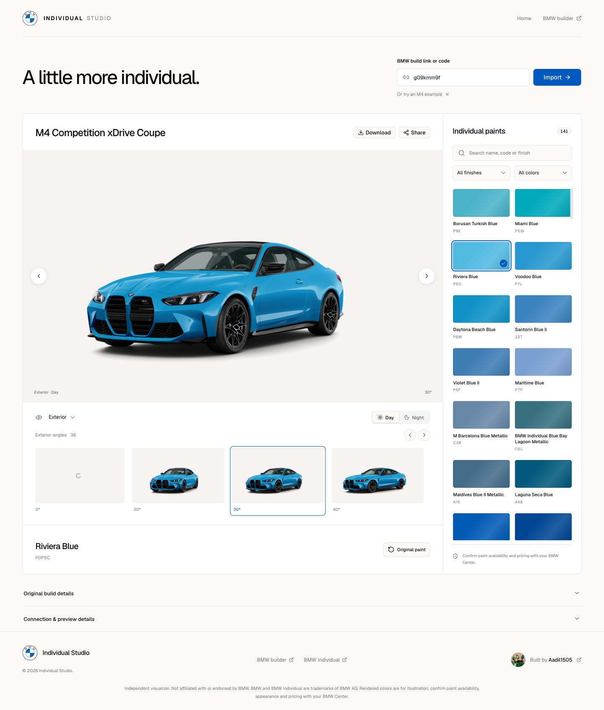

# BMW Individual Studio

See your BMW build in more Individual colors.

Import a BMW USA build link or configuration code, explore the model’s live Individual paint palette, and preview your selection while keeping the original wheels, upholstery, trim, and equipment.



## Features

- **Import your build** from a BMW USA configuration code or builder link.
- **Explore live paint options** with name/code search, finish filters, and color families.
- **Preview exterior and interior views** using the cameras returned for your build, with day and night lighting.
- **Share your configuration** through a URL that tracks your paint, camera, angle, and lighting.
- **Download the current image** directly from the browser.
- **Recover from failures** with clear errors, retries, and request diagnostics.

## Run locally

Requires [Bun](https://bun.sh/) **1.3.14** and a supported Node.js runtime for Next.js. Python 3 is needed only for the static preview.

```sh
bun install --frozen-lockfile
bun run dev
```

Open [localhost:3000](http://localhost:3000). No environment variables, API keys, or database setup are required. BMW’s endpoints must be reachable from your browser.

To explore the app, select **Or try an M4 example**, or import your own build from the [BMW USA builder](https://www.bmwusa.com/build-your-own.html).

## Commands

| Command                | Purpose                                                        |
| ---------------------- | -------------------------------------------------------------- |
| `bun run dev`          | Start development with live reload                             |
| `bun run check`        | Check formatting, lint, run tests, and build the static export |
| `bun run format`       | Format source and documentation                                |
| `bun run format:check` | Check formatting without changing files                        |
| `bun run lint`         | Run ESLint                                                     |
| `bun run typecheck`    | Check TypeScript types                                         |
| `bun run test`         | Run the protocol and share-link tests                          |
| `bun run build`        | Generate the static site in `out/`                             |
| `bun run preview`      | Serve `out/` locally, including the custom 404 page            |

## Project structure

```text
app/                 Pages, root layout, error boundaries, metadata, and global CSS
components/
  layout/            Shared navigation, footer, and branding
  studio/            Import flow, visualizer, sharing, and recovery UI
  ui/                Generated shadcn/ui primitives
hooks/               Client-side build, paint, and render state
lib/bmw/             BMW requests, response types, render codec, and share URLs
public/              Static install icons
scripts/             Local static preview server
tests/              Protocol and share-link tests
docs/               Architecture, development guide, and screenshots
```

The app uses **Next.js, React, TypeScript, shadcn/ui, Tailwind CSS, and Embla Carousel**. Theme tokens, shared styles, and responsive rules live in `app/globals.css`.

See [Architecture](docs/architecture.md) for the data flow and [Development](docs/development.md) for contribution and deployment details.

## Deployment

```sh
bun run build
```

Publish **`out/`** to a static host. Configure its missing-page response to serve `404.html` with HTTP 404 status. The local preview already does this:

```sh
bun run preview
```

All build, palette, and image requests go directly from the visitor’s browser to BMW. The deployed app has no API routes, database, server-side rendering, or server image optimization. Hosting providers may still charge for builds, static requests, and bandwidth.

Before publishing, test import, paint selection, shared links, and downloads from your final HTTPS domain; localhost testing does not establish production CORS compatibility.

## Scope and limitations

This tool imports **BMW USA** build links and uses the Individual catalog returned for the matching model. Camera views and paints depend on BMW’s live data. Ambiguous model variants require an explicit selection; missing paints and variants are never silently substituted.

BMW’s public endpoints and render encoding are undocumented dependencies and may change. A visualized paint is not confirmation that a particular vehicle or equipment combination can be ordered. Screen colors are illustrative; confirm appearance, availability, and pricing with your BMW Center.

## Credits

Created by [Aadil1505](https://github.com/Aadil1505).

An independent project, not affiliated with or endorsed by BMW. BMW and BMW Individual are trademarks of BMW AG. Vehicle images, paint data, and BMW branding belong to their respective owners.
